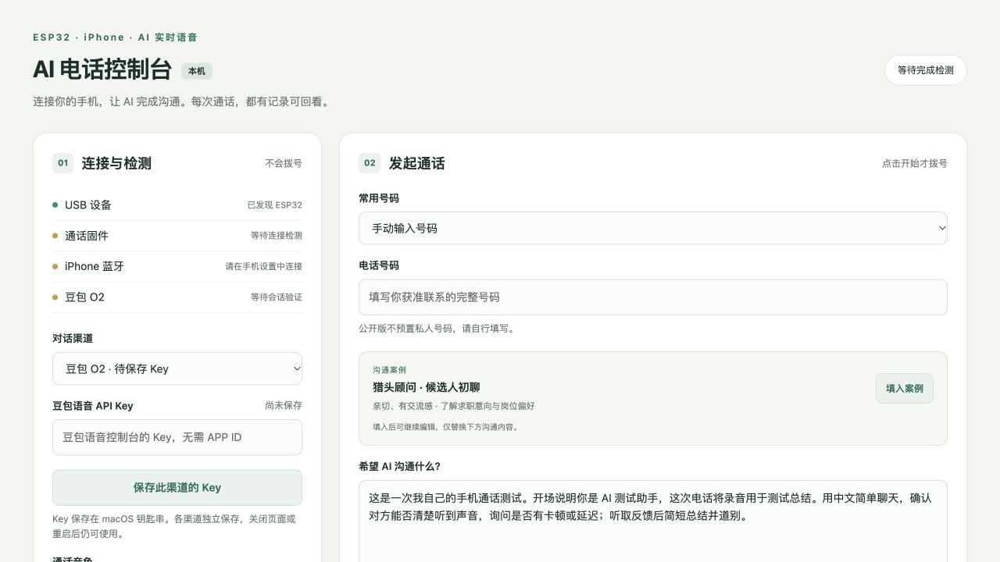
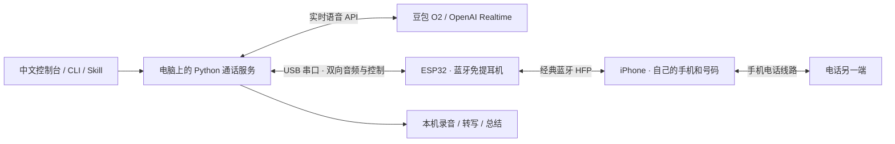

# AI Phone Bridge · 让 AI 用自己的手机打电话

**用一块 ESP32，把电脑上的 AI 接到你现有的手机和号码，完成一通真实电话。**

手机不需要安装专用 App，也不需要越狱。ESP32 作为蓝牙通话耳机，电脑负责实时 AI 对话；在中文控制台中填写号码和 Prompt，选择豆包 O2 或 OpenAI Realtime，通话结束后回看双方录音、转写和总结。

项目已完成真实电话验证，通话体验仍在改进。目前实测组合是 **macOS + 经典 ESP32 + iPhone 14**。



*控制台初始界面：渠道选择、连接检测与通话配置。*

## 功能

| 能力 | 你可以做什么 |
| --- | --- |
| 中文网页控制台 | 检测 USB、固件、手机蓝牙和 AI 会话，明确点击后发起通话，随时结束 |
| 两家实时语音 AI | 在豆包 O2 与 OpenAI Realtime 之间切换，分别保存 Key |
| 自定义 Prompt | 描述身份、风格、任务与结束条件；内置猎头初聊案例可继续编辑 |
| 蓝牙主动重连 | 固件记住最后成功连接的已配对手机，并在允许重连时主动尝试恢复连接 |
| 可回看的结果 | 双方 WAV、实时文字、正式转写、通话状态与总结 |
| Agent 接口 | 保留命令行与 WorkBuddy 项目 Skill，支持明确指定的单次电话任务 |

蓝牙自动重连恢复的是连接，**不会自动拨号或继续上一次 AI 通话**。它通过尝试连接判断手机是否可达，不测距。真实“走远后再回来”的效果还需要现场验证。

## 它怎样工作



USB-C 接电脑；ESP32 与手机之间走蓝牙。AI 模型运行在云端，ESP32 负责连接和音频桥接。

通话使用手机自身的线路和号码，无需另接云电话线路；手机通话资费和 AI API 费用仍然存在。

## 已经跑到哪一步

| 验证项 | 当前结果 |
| --- | --- |
| OpenAI 真实电话 | 完成约 63 秒通话，双向音频、打断、AI 结束、挂断确认和录音总结通过 |
| 豆包真实电话 | 完成约 104 秒通话，双向录音、实时转写、AI 结束和总结通过 |
| 新重连固件 | 实机主动连接成功；命令暂停后保持断开，恢复后重新连接成功 |
| 手机超距后返回 | 固件逻辑与模拟测试已覆盖；真实走远再返回尚未验证 |
| 流畅度 | 电话测试中出现过卡顿和延迟；已修复一处音频拼帧问题，实际听感仍需复测 |
| 跨平台与其他手机 | 尚未验证；网页的 Key 保存依赖 macOS 钥匙串 |

详细证据和验证边界见 [验证记录](docs/validation.md)。现有测试尚不足以确认达到真人沟通的流畅度。

## 开始使用

需要：一块支持 **经典蓝牙 HFP** 的 ESP32 开发板、USB 数据线、macOS 电脑、手机，以及至少一家实时语音 API 的使用权限。不是所有名为 ESP32 的芯片都适用；本项目只实测 ESP32-D0WDQ6-V3。

```sh
git clone https://github.com/ivanxia1988/ai-phone-bridge.git
cd ai-phone-bridge
python3 -m venv .venv
.venv/bin/python -m pip install -r requirements.txt platformio pytest esptool
```

首次使用先按 [使用指南](docs/使用指南.md) 构建与烧录固件、完成蓝牙配对，再启动控制台：

```sh
.venv/bin/python -m phone_bridge.ui --background
```

打开 <http://127.0.0.1:8787>，保存所选渠道的 Key，检测连接，填写获准联系的号码与 Prompt，点击“开始 AI 通话”。macOS 也可双击 `启动电话控制台.command`。

页面检查和切换 AI 源不会自动拨号；失败不会自动重拨。录音保存在本机 `calls/`，不会随仓库发布。涉及实际沟通和录音时，先获得适用的授权。

## 开发方向与反馈

- 电话中的延迟、停顿、打断和自然表达。
- 不同手机与蓝牙断线原因下的自动重连。
- 简短、目标清楚、可以检查结果的电话任务与 Prompt。
- 中文使用体验，以及其他操作系统的运行方式。

可以用中文 [提交 Issue](https://github.com/ivanxia1988/ai-phone-bridge/issues)，反馈设备、使用场景和观察结果。贡献方式见 [CONTRIBUTING](CONTRIBUTING.md)。

## 更多说明

- [技术方案与功能](docs/核心创意.md)
- [完整使用指南](docs/使用指南.md)
- [实测记录与当前限制](docs/validation.md)
- [固件说明](firmware/README.md)

## 来源与许可证

固件基于 [5iop/esp32-hfp-bridge](https://github.com/5iop/esp32-hfp-bridge) 的 HFP 音频桥接实现，固定来源提交为 `2366c3c721fa189bef325d31502333e5842bc01b`，保留原 SPDX 标记。这个项目在其基础上补充 UART0 板载 USB 传输、AI 通话服务、控制台、双渠道、Prompt、结果记录与主动重连。

Python 服务、控制台、测试和新增文档采用 [MIT](LICENSE)。固件保留上游的版权及 SPDX 声明；带有 `Unlicense OR CC0-1.0` 标记的文件可按对应许可使用，附 [Unlicense 文本](firmware/LICENSE)。根目录 MIT 不覆盖未明确授权的上游文件，来源与范围见 [NOTICE](NOTICE.md)。
